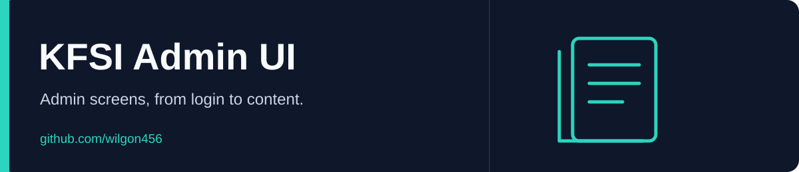

<div align="center">



# KFSI Admin UI

콘텐츠 관리와 계정 화면을 구현한 정적 관리자 UI 학습 프로젝트입니다.

[English](README.md) · **한국어**

 

[Repository](https://github.com/wilgon456/KFSI_webAdmin_rebuild)

</div>

---

## 화면

- 관리자 로그인과 기본 홈 화면
- 콘텐츠 목록·등록·카테고리 관리
- 콘텐츠 이동·삭제 팝업
- 비밀번호 찾기·변경과 이메일 인증 템플릿

## 로컬 미리보기

```bash
git clone https://github.com/wilgon456/KFSI_webAdmin_rebuild.git
cd KFSI_webAdmin_rebuild
python3 -m http.server 8000
```

**http://localhost:8000**에서 시작합니다. **http://localhost:8000/html/home.html**, **http://localhost:8000/html/contentsManagement.html**처럼 각 화면을 직접 열어 볼 수도 있습니다.

## 파일 구성

| 경로 | 용도 |
| --- | --- |
| `index.html` | 로그인 화면 |
| `html/` | 관리자 페이지·팝업 |
| `css/` | 화면별 스타일·공통 레이아웃 |
| `verifyEmailForm.html` | 이메일 인증 레이아웃 |
| `src/` | 로고 이미지 |

## 구현 범위

화면 구성을 보여 주는 프로젝트입니다. 백엔드, 실제 로그인, 콘텐츠 저장 기능은 제공하지 않습니다. 일부 링크와 동작은 예시이며 KFSI의 공식 서비스가 아닙니다.
